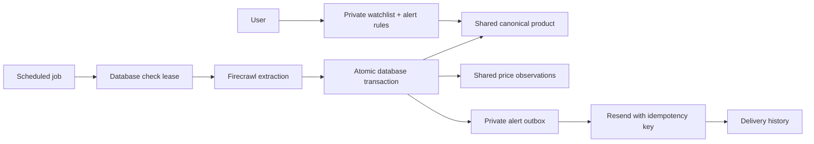

# ProductTrack

A price watchlist that helps shoppers buy at their target price. Built with Next.js, Supabase/Postgres, Firecrawl, Resend, Tailwind, the existing visx chart system, and Recharts.

## Try it

`/demo` is an interactive, read-only watchlist with clearly labeled sample data. Explore store filters, search, sorting, target preferences, and price history without signing in. `/tracker` is your private, authenticated watchlist.

## What it does

- Product-led watchlist with compact counts, real images, interactive price trends, individual targets, and sidebar navigation, alert history and tracking status.
- Target-price and percentage-drop alerts with configurable email delivery and pause/resume.
- Recorded lowest/highest prices, personal baseline, and a historical median after at least five checks spanning a day.
- One shared product and observation stream per canonical retailer URL, with separate private user watchlists.
- Atomic price updates and alert creation, database leases for overlapping jobs, and delivery retries with provider idempotency keys.
- Mobile layouts, keyboard accessible dialogs, meaningful empty/error states, and image fallbacks.

## Local setup

Requires Node 22.6+ for the test runner's TypeScript support and pnpm.

```sh
pnpm install
cp .env.example .env
# Fill in the credentials for your own Supabase, Firecrawl and Resend projects.
pnpm db:migrate
pnpm dev
```

The migration expects the original `products` and `price_history` tables in a Supabase database. It runs once, in a transaction, and creates a private backup in `.local-backups/` before applying changes. Existing users and histories are preserved. Duplicate trackers for the same user/canonical URL are consolidated into the oldest tracker; their legacy price observations are retained. The migration replaces old access policies with owner-only watchlist/alert policies and membership-based reads of shared prices. Inserts and shared price writes go through the authenticated server action and service client.

Do not use `db:push` as a substitute: the SQL migration installs the RLS policies, grants, triggers and transactional functions that Drizzle's table schema does not represent. Coordinate the database migration with deploying this version, as the old application writes directly through permissions that are tightened by the migration.

The service-role key stays on the server. Never use it in browser code or commit `.env` or backups. Resend requires a verified sender domain.

## Schedule price checks

Configure your scheduler to request either GET or POST `/api/cron/check-price` with:

```text
Authorization: Bearer <CRON_SECRET>
```

Run it every 15 minutes. A shared product is eligible once per hour; each invocation checks up to 12 products with at most three concurrent extractions, then processes up to 50 queued emails. Failed extraction checks back off for 15 minutes. Adapt batch size/frequency and the function timeout to your hosting plan and catalog size. `maxDuration` is 300 seconds and requires a compatible host.

Paused watchlists do not trigger alerts. A shared product may still update if another user tracks it. Alerts use the price when that user added the item as the percentage-drop baseline. If both target and drop rules are set, either can trigger. The rule sends once on entry into the eligible range and rearms only after the price leaves that range, or the preferences change. Preference changes are evaluated on the next successful check.

Failed emails are retried for up to five attempts within 23 hours, using the event ID as a stable Resend idempotency key. Expired ambiguous deliveries are cancelled to stay within the provider's deduplication window. The Alert history page shows sent, pending, failed, and cancelled events.

Supported full HTTPS links: Amazon (selected regional domains), Flipkart, Myntra, AJIO, Croma, Meesho. Affiliate parameters are removed; Amazon variant parameters and Flipkart product IDs are retained. Short links are intentionally rejected. Retailer redirects, availability, login requirements, and extraction failures can affect coverage.

## Architecture



`products` remains the private watchlist table, linked to `catalog_products`. `catalog_price_history` records every successful check, including unchanged prices. `price_history` retains the pre-migration observations. Database leases prevent duplicate extractions and concurrent email delivery. RLS restricts users to their own watchlists and alerts; only watchers can read a product's shared history. `/p/[id]` requires ownership and is not a public sharing endpoint.

History statistics describe recorded checks, not every price ever offered. Earlier observations were recorded only when prices changed, so the median is an observation median rather than a time-weighted typical price. Different variants/currencies must not be mixed; currency changes are rejected and surfaced as failed checks. No future-price predictions or purchase savings are invented.

## Validation

```sh
pnpm test
pnpm typecheck
pnpm build
pnpm lint
```

Tests cover URL identity and rejected hosts, statistical baselines, rule boundaries, database backfill, RLS access isolation, atomic fan-out, alert crossing/rearming, paused rules, concurrent leases and deletion. Database tests run in an isolated PGlite database; they do not connect to your real database, scrape retailers or send email.

The original custom chart library has existing repository-wide lint errors. The tracker reuses the existing visx chart system; its optional price range is supplied only by tracker consumers. The product detail page uses the Recharts history component.

## Portfolio walkthrough

1. Open `/demo` and explain target-driven buying decisions.
2. Show product history, recorded median context, and a target reference line.
3. Filter by store or price, then inspect the alert history and tracking status from the sidebar.
4. Explain why separate user rules share one extraction per canonical product.
5. Discuss leases, atomic transactions, private ownership policies and email deduplication.

For a live alert demonstration, use your own product and verified email. Do not present sample history as live data.

Implementation references: [Supabase row-level security](https://supabase.com/docs/guides/database/postgres/row-level-security), [database functions](https://supabase.com/docs/guides/database/functions), and [Resend idempotency keys](https://resend.com/docs/dashboard/emails/idempotency-keys).

## Project skills

Installed locally with the requested skills CLI: `transitions-dev`, `improve-ui`, and `improve-animations`. Sources and hashes are recorded in `skills-lock.json`; the skill files live in `.agents/skills/` and will be discoverable on future turns. Tracker implementation decisions are recorded in `design-plans/tracker-ui.md` and `animation-plans/001-tracker-interactions.md`. CSS hooks and motion are scoped to the tracker and its sample demo. The shared header has a wider variant only for tracker/detail routes; the landing variant is unchanged.

Demo photographs are frozen retailer thumbnails in `public/demo-products/`. Their sources are recorded alongside them. All demo prices and alert events are illustrative.

The sort and range controls use the [shadcn Select](https://ui.shadcn.com/docs/components/radix/select), and mobile navigation uses the [shadcn Sheet](https://ui.shadcn.com/docs/components/radix/sheet), installed from the official new-york registry and wired to the existing `radix-ui` dependency. Product clicks navigate to `/p/[id]` or `/demo/p/[id]`. The tracker and detail page share the existing smooth area chart and one typography system.

### Shopping workspace

Migration `002_shopping_workspace.sql` adds five tracker features:

- **Collections and budgets:** private folders in one currency. A collection shows actual spending, one unit per unpurchased listing, and the remaining budget after planned purchases. Wishlist totals exclude delivery and flag missing prices. Move products using their options menu.
- **Store comparisons:** add a supported retailer URL or select an existing tracker on the product detail page. Confirm the exact model and variant before linking. Delivered totals require a quoted or manually entered delivery fee. A lowest delivered price is shown only for at least two explicitly in-stock offers with known fees. Listings are user linked; there is no automatic model matching or store discovery.
- **Restock alerts:** enable independently in Tracking alerts. Only a recorded out-of-stock → in-stock transition queues an email. Missing/unknown availability cannot trigger it; checks without a price record availability without fabricating price history. Uses the existing authenticated scheduled worker and retry outbox.
- **Purchase history:** “Mark as bought” records actual price, quantity and purchase date, pauses the tracker and removes it from the unpurchased watchlist. Savings use the price when added, not MRP. Purchase snapshots survive tracker deletion. Removing a purchase restores its earlier pause state when the tracker still exists.
- **Shareable wishlists:** explicitly enable a public collection link. The anonymous page exposes only the collection name/description and unpurchased listings with prices/availability. Budgets, account information, purchases and alert rules stay private. Revoking the link takes effect immediately; enabling it again generates a new token.

Explore sample collections, purchases and comparisons at `/demo`, `/demo/p/demo-0` and `/s/demo-desk`. Demo mutations display a preview notice and never write to the database. No browser extension is included.

`pnpm db:migrate` maintains a migration ledger and creates a restricted local JSON backup before every pending migration. Keep `.local-backups/` private. The workspace tests exercise ownership boundaries, anonymous sharing/revocation, purchase snapshots, explicit comparison confirmation and deduplicated restock notifications in an isolated database.
